<!-- ════════════════════════════════════════════════════════════════
     vedantb7 · GitHub Profile README
     Assets: /assets  |  Snake CI: /.github/workflows/snake.yml
════════════════════════════════════════════════════════════════ -->

<!-- ┌─────────────────────────────────────────────────────────────┐
     │  SECTION 1 — HEADER + SOCIALS                              │
     └─────────────────────────────────────────────────────────────┘ -->
<div align="center">

<picture>
  <source media="(prefers-color-scheme: dark)"  srcset="assets/header.svg">
  <source media="(prefers-color-scheme: light)" srcset="assets/header.svg">
  
</picture>

<br/>

<!-- Social badges -->
[](https://www.linkedin.com/in/vedant-bondekar-937808322/)
[](https://vedantb7.github.io/)
[](mailto:vedantbondekar@gmail.com)
[](https://github.com/vedantb7)
[](https://github.com/vedantb7)

</div>

---

<!-- ┌─────────────────────────────────────────────────────────────┐
     │  SECTION 2 — BIO + TECH STACK                             │
     └─────────────────────────────────────────────────────────────┘ -->

```
▸ B.Tech Computer Science · IIT Gandhinagar
▸ Build close to the metal — systems, networks, and security first.
▸ Philosophy: Understand the system completely before you optimize it.
```

<div align="center">

<picture>
  <source media="(prefers-color-scheme: dark)"  srcset="assets/tech-stack.svg">
  <source media="(prefers-color-scheme: light)" srcset="assets/tech-stack.svg">
  
</picture>

</div>

---

<!-- ┌─────────────────────────────────────────────────────────────┐
     │  SECTION 3 — FEATURED PROJECTS                            │
     └─────────────────────────────────────────────────────────────┘ -->

<div align="center">

<picture>
  <source media="(prefers-color-scheme: dark)"  srcset="assets/projects.svg">
  <source media="(prefers-color-scheme: light)" srcset="assets/projects.svg">
  
</picture>

</div>

---

<!-- ┌─────────────────────────────────────────────────────────────┐
     │  SECTION 4 — CONTRIBUTION SNAKE                           │
     └─────────────────────────────────────────────────────────────┘ -->

<div align="center">

<picture>
  <source
    media="(prefers-color-scheme: dark)"
    srcset="https://raw.githubusercontent.com/vedantb7/vedantb7/output/github-snake-dark.svg"
  />
  <source
    media="(prefers-color-scheme: light)"
    srcset="https://raw.githubusercontent.com/vedantb7/vedantb7/output/github-snake.svg"
  />
  
</picture>

</div>

---

<div align="center">

> **"Programs are meant to be read by humans and only incidentally for computers to execute."**

</div>
